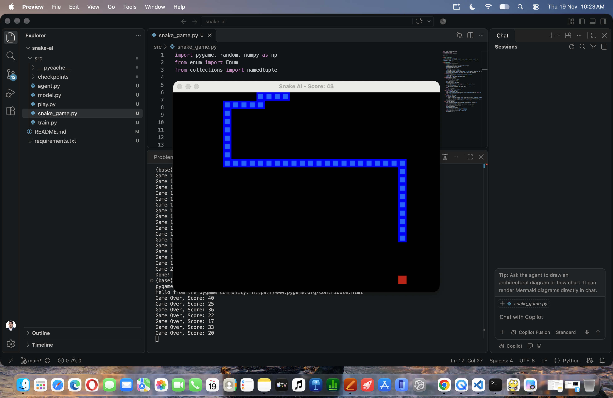

# Snake AI - Deep Q-Learning

Neural network learns to play Snake by itself using Deep Q-Network (DQN).

## Demo



## How it Works
- **State (11 values):** Danger straight / right / left, Direction (4), Food left/right/up/down (4)
- **Actions (3):** Straight, Turn Right, Turn Left
- **Rewards:** Food +10, Death -10, Else 0
- **Model:** Linear Q-Network 11 -> 256 -> 3, Gamma 0.9, Memory 100k, Batch 1000

## Results
- Starts: Score 0-1, dies on walls
- After 100 games: Learns to avoid walls, Score 5-10
- After 200 games: Score 30-80 consistently, Best Score 80
- Best Score: **80 in 200 games** - After training, AI consistently scores 30-70+

## How to Run
```bash
pip install -r requirements.txt
cd src
python train.py   # Train - game window will open
python play.py    # Watch trained AI play
```

## Files
- `src/snake_game.py` - Pygame Snake game
- `src/agent.py` - DQN Agent + QTrainer
- `src/model.py` - Linear Q-Network
- `src/train.py` - Training loop
- `src/play.py` - Play with trained model
